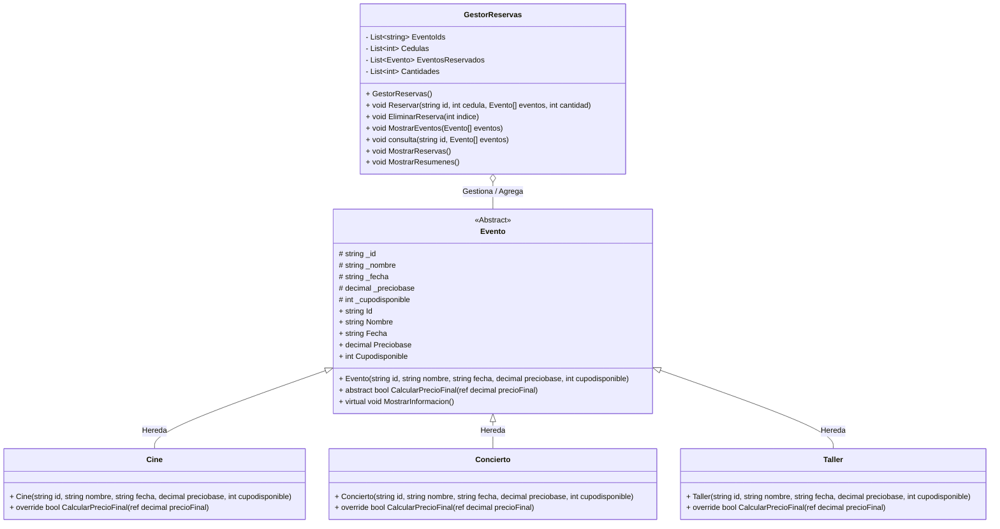

# Planazo - Sistema de Gestión de Reservas (C# POO)

Aplicación de consola desarrollada en C# orientada a objetos (POO) para la gestión y reserva de entradas a diferentes tipos de eventos (Cine, Conciertos y Talleres), implementando polimorfismo, manejo de listas paralelas y control robusto de excepciones.

---
## 🛠️ Funcionalidades Destacadas

### 1. Cálculo Polimórfico de Precios
El sistema gestiona dinámicamente el precio de cada entrada según el tipo de evento seleccionado:
* **Cine:** Cobra la tarifa base fija.
* **Taller:** Aplica un **10% de descuento** sobre el precio base.
* **Concierto:** Aplica un **15% de recargo** sobre el precio base.

### 2. Gestión de Reservas y Cupos en Tiempo Real
A través del servicio `GestorReservas`, la aplicación:
* Verifica automáticamente si existen cupos disponibles antes de confirmar la compra.
* Descuenta las entradas vendidas de la capacidad máxima del evento.
* Restaura los cupos del evento cuando el usuario decide cancelar una reserva.

### 3. Registro por Listas Paralelas
Utiliza cuatro listas sincronizadas para almacenar y consultar de forma ordenada:
* ID del evento reservado.
* Cédula del cliente.
* Instancia del objeto evento (`Cine`, `Concierto` o `Taller`).
* Cantidad de entradas compradas.

### 4. Manejo Robusto de Excepciones
El sistema previene cierres inesperados frente a errores comunes del usuario:
* Captura de `FormatException` cuando se ingresan caracteres no numéricos en cédulas o cantidades.
* Captura de `OverflowException` al ingresar valores que superan el rango de enteros permitidos.
---
## ⚙️ Cómo Ejecutar el Proyecto

Para poner en marcha la aplicación utilizando la terminal, asegúrate de tener instalado el [SDK de .NET](https://dotnet.microsoft.com/) en tu equipo.

### Desde la Terminal Integrada de Visual Studio Code:
1. Abre la carpeta del proyecto en VS Code.
2. Abre la terminal integrada presionando las teclas `Ctrl + ~` (o ve al menú superior en **Terminal > New Terminal**).
3. Verifica que te encuentres ubicado en la ruta raíz donde está el archivo de proyecto (`PLANAZO_POO_CSharp.csproj`).
4. Ejecuta el comando de compilación y ejecución automática: `dotnet run`
## 🚀 Características Principales
---
## Explicación del Código / Sustentación
"La clave de la arquitectura radica en la clase abstracta Evento. Dado que los cines, conciertos y talleres comparten características y atributos fundamentales, heredan de esta clase base. Esto nos permite aplicar el principio de reutilización de código (POO) para no tener que declarar variables una por una en cada clase.

En la clase principal (Program.cs), instanciamos los objetos de cada evento con su información correspondiente. Para facilitar su manipulación y consulta centralizada, encapsulamos todas estas instancias dentro de un arreglo (Evento[]), lo que permite iterar, enviar y consultar cualquier evento sin ningún tipo de conflicto.

Por otro lado, la clase GestorReservas actúa como el núcleo de la lógica de negocio. Es el encargado de coordinar todas las acciones del sistema: crear reservas, consultarlas, mostrarlas y eliminarlas. Al realizar una reserva, no solo guardamos datos primitivos, sino la instancia completa del objeto evento, manteniendo la integridad de la información.

Finalmente, aplicamos encapsulamiento y propiedades en todo el modelo para garantizar la seguridad y protección de los datos contra modificaciones no autorizadas."

Puntos Clave que Resalta esta Explicación:
Clase Abstracta e Herencia: Justifica el uso de Evento como base para evitar duplicación de código.

**Encapsulamiento en Arreglo:** Explica por qué agrupamos los eventos en un Evento[].

**Controlador de Negocio (GestorReservas):** Define con claridad la función centralizada del gestor.

**Seguridad (POO):** Destaca el uso de propiedades para asegurar el acceso a los datos.
---
* **Polimorfismo en Precios:** Cada tipo de evento calcula su precio final de manera personalizada mediante el método `CalcularPrecioFinal`:
  * **Cine:** Precio base regular.
  * **Taller:** 10% de descuento aplicado sobre el precio base.
  * **Concierto:** 15% de recargo sobre el precio base.
* **Gestión de Inventario y Cupos:** Control automático de capacidad máxima y actualización en tiempo real de los cupos disponibles al reservar o cancelar.
* **Listas Paralelas:** Almacenamiento sincronizado de reservas mediante estructuras de listas para IDs de eventos, cédulas de clientes, objetos de eventos y cantidades.
* **Control de Errores:** Validación de entradas por teclado mediante bloques `try-catch` para evitar caídas del sistema por excepciones de formato (`FormatException`) o desbordamiento (`OverflowException`).
---
## 🧬 Aplicación de los Pilares de la Programación Orientada a Objetos (POO)

### 1. Abstracción
* **¿Dónde se usó?:** En la clase base `Evento`.
* **Explicación:** Se representaron las características esenciales de un evento del mundo real (como `ID`, `Nombre`, `Fecha`, `PrecioBase` y `CupoDisponible`) dentro de una plantilla general. La clase `Evento` se definió como `abstract` porque no se instancian "eventos genéricos", sino tipos específicos de eventos. Además, define la firma del método abstracto `CalcularPrecioFinal()`, obligando a que cada subclase defina cómo procesar su tarifa.

### 2. Herencia
* **¿Dónde se usó?:** En las clases `Cine`, `Concierto` y `Taller`.
* **Explicación:** Las subclases heredan directamente de la clase abstracta `Evento` (`public class Cine : Evento`, `public class Concierto : Evento`, etc.). Esto permite reutilizar todos los atributos, propiedades y métodos comunes de la clase padre sin necesidad de duplicar código ni volver a declarar las variables una por una en cada clase hija.

### 3. Encapsulamiento
* **¿Dónde se usó?:** En todos los modelos de clases (`Evento`, `Cine`, `Concierto`, `Taller`) y en el servicio `GestorReservas`.
* **Explicación:** Se protegió el estado interno de los objetos utilizando miembros privados (atributos) expuestos de forma controlada mediante **propiedades** públicas con sus correspondientes *getters* y *setters*. Asimismo, en `GestorReservas` las listas de almacenamiento se mantienen como colecciones internas de la clase, evitando que código externo modifique el estado de las reservas de forma no autorizada.

### 4. Polimorfismo
* **¿Dónde se usó?:** En la sobreescritura (`override`) del método `CalcularPrecioFinal()` en `Cine`, `Concierto` y `Taller`, y en la gestión unificada desde `GestorReservas`.
* **Explicación:** Cada subclase responde al mismo método `CalcularPrecioFinal()` pero ejecuta una lógica distinta según su tipo:
  * `Cine`: Devuelve el precio base regular.
  * `Taller`: Aplica dinámicamente un **10% de descuento**.
  * `Concierto`: Aplica un **15% de recargo**.
  Esto permite que el sistema trate todos los objetos dentro del arreglo `Evento[]` de forma uniforme mediante su clase padre, ejecutando la lógica correcta en tiempo de ejecución.
---

## 📂 Estructura del Proyecto

**¿Por qué utilizaste una clase abstracta `Evento` en lugar de crear clases completamente independientes para Cine, Concierto y Taller? ¿Qué ventajas tiene esta decisión cuando necesitamos agregar un nuevo tipo de evento?**
Tenemos la ventaja de no tener que declarar las varibles otra vez, evitando la repeticion de codigo y todas en si compartes bastantes caracteriticas, la ventaja al crear otro tipo de evento es que por ejemplo Partido de futbol solo tenemos que hacer que sea hija para que compartas las caracteristicas. Basicamente se uso una clase abstracta por el hecho de ser como una plantilla.
